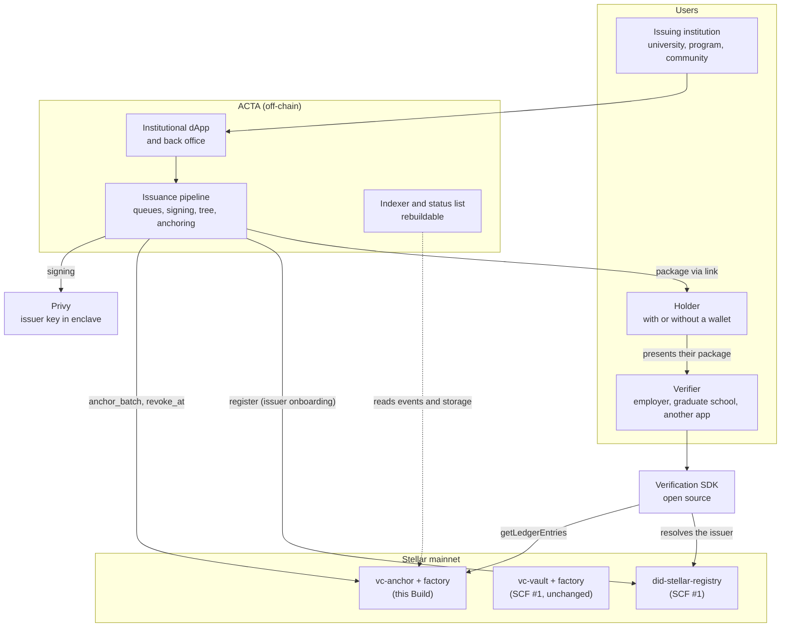
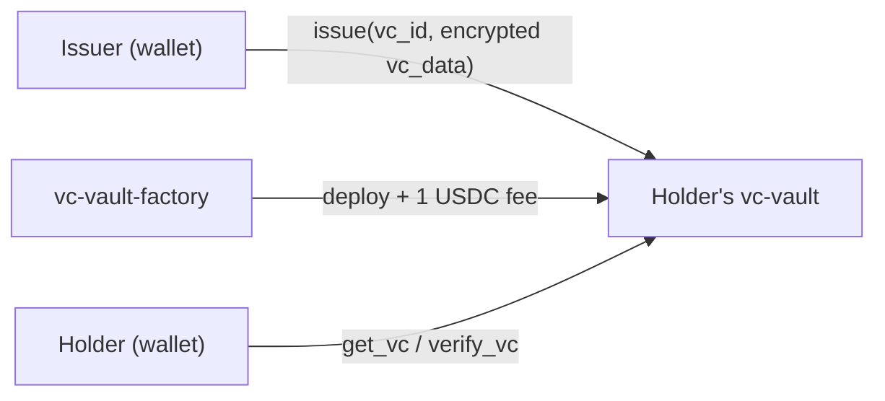
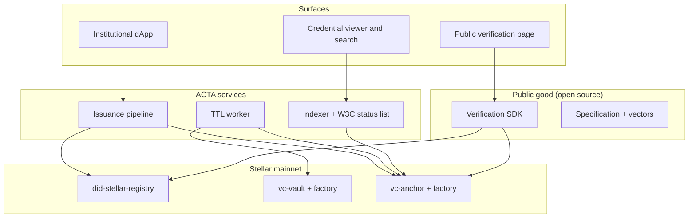
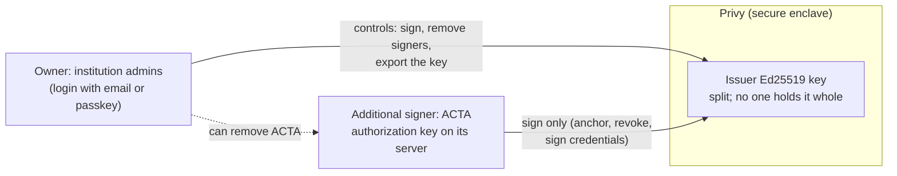
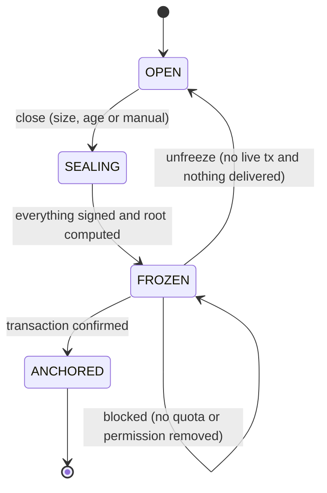
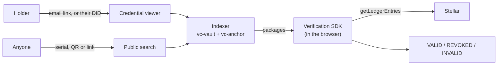
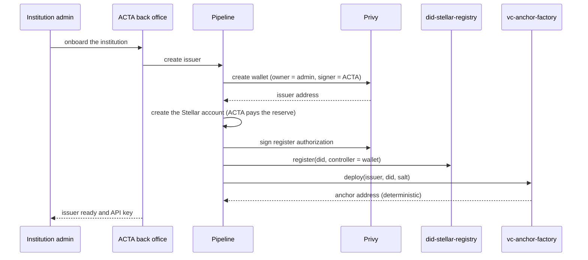
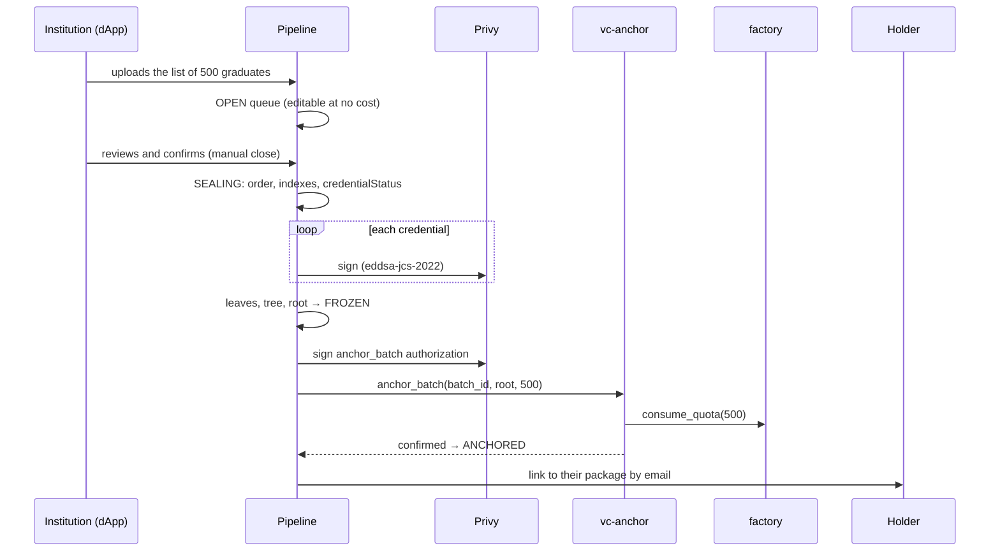
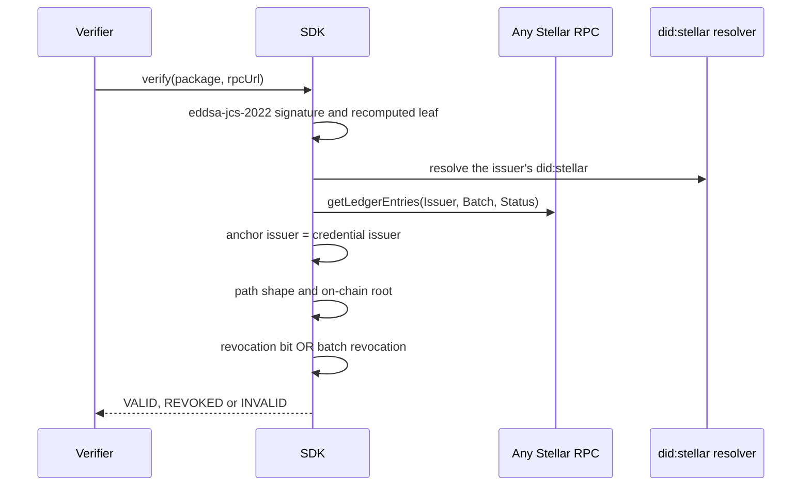
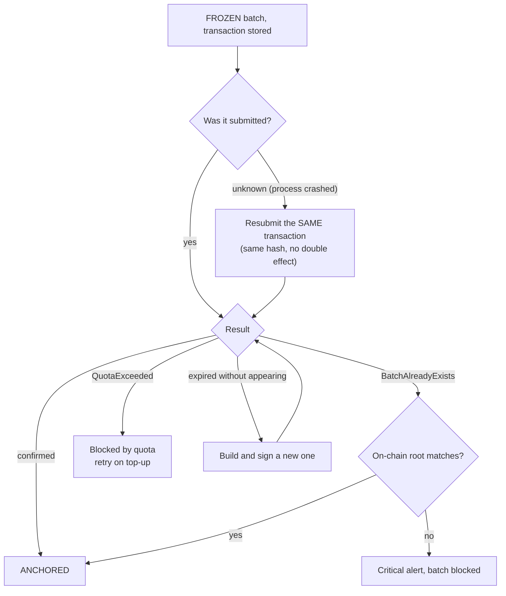

# Technical architecture | ACTA

This document describes the system ACTA runs today on Stellar mainnet and the one it will run once this Build Award closes.

| Field | Value |
|---|---|
| Website | https://acta.build |
| `did:stellar` resolver | https://did.acta.build |
| Network | Stellar mainnet |
| Public repos | github.com/ACTA-Team/contracts-acta · did-stellar · acta-credentials · acta-viewer |
| Anchoring specification and test vectors | Published in T1 at https://github.com/ACTA-Team/contracts-acta → `spec/vc-anchor/` (specification) and `spec/vc-anchor/test-vectors/` (vectors). Their content is summarized in Appendices A, B and C |

---

## 0. Reading guide

| Part | Question it answers |
|---|---|
| Part I | What works today on mainnet, and how? |
| Part II | What exactly does this Build deliver, and where does it connect to what already exists? |
| Part III | What happens, step by step, when issuing, verifying, revoking, or when something fails? |
| Part IV | Where are the trust boundaries, who can do what, and which threats do we cover? |
| Part V | Which component ships in which tranche, and how is it verified? |
| Appendices | Cryptographic conventions, contract interfaces, test vectors, public API, stack, links and glossary |

---

## 1. Overview

ACTA issues W3C verifiable credentials on Stellar. This Build adds a second way to issue them: **in batches**, with a single on-chain write per cohort, without the holder needing a wallet, and with revocation on-chain.

Four architectural commitments follow from that sentence, and every decision in this document derives from them:

1. **Verification never goes through ACTA.** Anyone verifies a credential by reading the Stellar ledger from the RPC of their choice. ACTA could disappear and the credentials would remain verifiable: intact and with their revocation status.
2. **Nothing personal on-chain.** Stellar stores a 32-byte root and one bit per credential. Personal data lives encrypted off-chain, and it can be deleted.
3. **The institution controls its key.** Nobody holds the key that signs the credentials: it lives in a secure enclave. The institution owns its wallet; ACTA holds a signing permission that the institution can remove.
4. **One more primitive, not another architecture.** Batch issuance uses the same identity (`did:stellar`), the same credential format, the same back office and the same SDK delivered under SCF #1. `vc-vault` stays as is, for the customer it already serves.

### 1.1 System context



---

# PART I: What already works on mainnet

Everything in this part has been on Stellar mainnet since 2026-06-30. It is presented as **evidence of capability, not as work to be funded**. It is also the foundation Part II builds on.

## 2. Identity: `did:stellar`

**What it is.** A Stellar-native DID method: the identifier `did:stellar:<network>:<id>` resolves to a DID document stored on-chain in the `did-stellar-registry` contract.

| Piece | Status |
|---|---|
| `did:stellar` specification v0.1 | Public |
| `did-stellar-registry` contract 0.2.0 | Mainnet: `CD6LSWW5ZSXOO5WAIHKQLQ262TW7BPI37PNEVMMA273BAPC65NN2AYXQ` |
| `@acta-team/did-stellar` SDK | npm |
| HTTP resolver compatible with the DIF Universal Resolver | https://did.acta.build |

**What it does in this Build.** It is each issuer's identity. Onboarding an institution registers its `did:stellar` (with `register`, as it exists on mainnet), and each anchor contract stores it at deployment. The verification SDK uses the resolver to obtain the issuer's public key. **The registry is not modified.**

## 3. One-by-one issuance: `vc-vault`

**What it is.** One contract per holder (their "vault") that stores each credential encrypted as its own on-chain entries. It is deployed by `vc-vault-factory`, which also charges the issuance fee.

| Piece | Status |
|---|---|
| `vc-vault` 0.4.0 | Template on mainnet (WASM `2bd0323a…a957`), instances via factory |
| `vc-vault-factory` 0.1.0 | Mainnet: `CCWNZ6UMUXCDOVP2TWOPVLI4KP4VY4YF7VKPN6XLYVHNFAT24NDB33CX` |
| Issuance fee | 1 USDC per credential, charged on-chain |



**Who it is for.** Individual, immediate issuance to holders with a wallet: wallets, dApps, claim systems. It remains in production and **this Build does not touch it**: zero regression risk for anyone who has already integrated.

## 4. Product layer

| Piece | What it is |
|---|---|
| API v1.2 | Production and sandbox hosts [PENDING: URLs], with API keys |
| `@acta-team/credentials` SDK 1.1.10 | API client for integrators (npm) |
| Back office | Manages issuers, vaults and API keys on testnet and mainnet |
| Viewer (`acta-viewer`) | Displays credentials and `did:stellar` identities |

## 5. Mainnet usage

| Metric (read from storage on 2026-10-06) | Value |
|---|---|
| Registered `did:stellar` DIDs | 11 |
| Deployed vaults | 139 |
| Credentials in `vc-vault` | 146 |

Validated with three external integrators (Sub Rosa, Genesis Coalition and Interactuar), with session logs and user testing reports.

## 6. What running in production revealed

On Soroban, storage is rented. `vc-vault` writes four persistent entries per credential, and each one pays rent for as long as it exists. For a web3 integration that cost is manageable. For someone issuing thousands of credentials per year, the accumulated rent exceeds what is charged.

| 500,000 live credentials over 5 years | Estimated rent |
|---|---|
| `vc-vault`, one write per credential | ~$290,000 to ~$441,000 |
| `vc-anchor`, batches of 500 | ~$222 to ~$338 |

Assumptions: ~700 B credential, 1 XLM = $0.172 (2026-08-01), Soroban rent between $0.000067 and $0.000102 per byte per year. [PENDING: direct measurement of a TTL extension on mainnet.]

Part II builds the primitive that this second customer needs.

---

# PART II: What this Build funds

Each section states **what it is**, **where it connects** to Part I, and **how it is accepted**. None of this requires re-architecture: each piece plugs into an interface that already exists (the registry, the credential format, the back office, the SDK).

| # | Funded deliverable | Section |
|---|---|---|
| 1 | `vc-anchor` contract | §8 |
| 2 | `vc-anchor-factory` contract | §9 |
| 3 | Batch issuance pipeline | §10 |
| 4 | Credential format and holder package | §11 |
| 5 | Open source verification SDK | §12 |
| 6 | Operational layer: TTL, indexer and status list | §13 |
| 7 | Product: dApp, credential viewer and search, verification page, issuer identity | §14 |

## 7. End state



## 8. `vc-anchor` contract

**What it is.** One contract per issuer that stores, for each batch, the Merkle tree root, the number of leaves, and a revocation bitmap with one bit per credential. It performs no cryptography: it receives a root and does not ask how it was built.

**Where it connects.** It is deployed by `vc-anchor-factory` (§9) with the issuer's `did:stellar` (§2). Its `issuer` is the issuer's wallet (§10.2): only that wallet can anchor and revoke.

**What it stores.**

| Entry | Type | Content |
|---|---|---|
| `Issuer` | instance | Issuer address; this is what the SDK compares against the credential's key |
| `IssuerDid` | instance | Issuer's `did:stellar` |
| `Factory` | instance | Address of the factory that deployed it |
| `Batch(batch_id)` | persistent | `BatchRecord { root, leaf_count, anchored_at, revoked }` |
| `Status(batch_id)` | persistent | Bitmap of `ceil(leaf_count / 8)` bytes, most significant bit first |

**Key behavior.**

- `anchor_batch(batch_id, root, leaf_count)`: requires the issuer's signature, rejects a `batch_id` already in use (batches are immutable), and asks the factory to consume `leaf_count` from the quota **before** writing. If there is no quota, the whole call reverts.
- `revoke_at(batch_id, index)`: sets a bit. `revoke_batch(batch_id)`: marks the entire batch as revoked with a single flag. A credential's status is `bit OR revoked`.
- Reads without invoking the contract: the SDK reads `Issuer`, `Batch` and `Status` directly from the ledger with `getLedgerEntries`. It pays no fees and does not depend on ACTA.
- Limits: `batch_id` up to 64 bytes, `leaf_count` between 1 and 65,536.
- TTL: every write extends the batch to ~180 days. Any account can extend or restore it, permissionlessly.
- **What it deliberately lacks:** it cannot delete or rewrite a root, it has no upgrade function, and it stores no personal data.

**Acceptance.** Contract on testnet with a test suite: anchoring, duplicates, limits, authorization, individual and batch revocation, and quota consumption.

## 9. `vc-anchor-factory` contract

**What it is.** Deploys one `vc-anchor` per issuer from a fixed WASM, keeps the registry of which contracts are legitimate anchors, and tracks each issuer's on-chain quota.

**Where it connects.** ACTA (the factory admin) uses it when onboarding each institution (§15). Each `anchor_batch` calls `consume_quota` on the factory.

**Key behavior.**

- `deploy(issuer, issuer_did, salt)`: deterministic address, so a retry never deploys twice.
- **The anchor WASM is immutable**: it is set in the constructor. An issuer cannot point to a modified anchor.
- **`consume_quota` does not take the issuer as input**: it resolves it from the address of the calling anchor. One anchor cannot spend another issuer's quota.
- Quota: `apply_tier` sets the period's quota, `grant_quota` adds extra credits, `set_quota` adjusts it. The tier table lives in contract state, not in code: changing a plan is a transaction, not a redeploy.
- `remove_anchor` decommissions an anchor without affecting the others. Its batches remain verifiable.

The on-chain quota is a **safety net** against a leaked key or a bug that anchors in a loop. It is not a billing system.

**Acceptance.** Contract on testnet with a test suite: deterministic deployment, quota (consumption, exhaustion, plan reset, extras) and authorization.

## 10. Issuance pipeline

**What it is.** The service that receives credentials, accumulates them in queues, signs them, builds the tree, anchors the root and delivers the package to each holder. It is the only component that writes to `vc-anchor`.

**Where it connects.**
- Institutions use it from the dApp or via the API, with the same API keys the back office issues today.
- Each issuer's onboarding uses the SCF #1 registry.
- Credentials are issued in the same W3C profile as v1 (§11).

**Modules.**

| Module | Responsibility |
|---|---|
| `anchoring` | Credentials, per-group queues, batches, tree, package, revocation, status list |
| `issuers` | Issuer onboarding: wallet, Stellar account, `did:stellar`, anchor deployment |
| `access` | API keys issued from the back office, with per-scope and per-network permissions |
| `quotas` | Issuer quota, synchronized with the factory |
| `notifications` | Notices to other ACTA services when a batch is anchored or something is revoked |
| `chain-maintenance` | TTL, restoration and event indexing (§13) |

Stack: Node.js 24 + TypeScript, Fastify, PostgreSQL (source of truth) and Redis (queues). Billing is an ACTA commercial layer outside this budget: it translates payments into idempotent calls to `apply_tier` and `grant_quota`.

### 10.1 Issuer onboarding

1. The issuer's wallet is created in Privy (§10.2).
2. ACTA creates the Stellar account for that wallet and pays its reserve. The wallet does not need XLM.
3. Its `did:stellar` is registered: the controller is the institution's wallet, which signs the authorization, and ACTA pays the fee and rent.
4. The factory deploys its `vc-anchor` with that DID.

Each step is idempotent: a retry checks on-chain state before repeating.

### 10.2 Issuer key custody



- The private key lives split inside a secure enclave and is only reconstructed for an instant to sign. Neither Privy, nor ACTA, nor the institution holds it whole.
- The institution is the owner: it can revoke ACTA's permission and export its key to issue on its own.
- ACTA is an additional signer: it signs automatically, but it cannot change the owner, add signers or export the key.
- If the institution removes the permission, the pipeline detects it, keeps batches queued, and sends a notice.
- **The same key plays two roles:** it signs each credential (Ed25519, `eddsa-jcs-2022`) and authorizes each anchoring transaction. That is why the SDK can check that whoever anchored is whoever signed (§12, check 4).

### 10.3 Batch lifecycle



- **One queue per group** (course, cohort or campaign), not per issuer. While it is `OPEN`, the issuer can edit or remove credentials at no cost: this is the window to fix mistakes.
- **Close policy** in three fields: maximum size, maximum age (measured from the oldest credential) and manual close.

| Preset | Size | Age | Manual | Use case |
|---|---|---|---|---|
| Event | - | - | yes | Graduation: closes when the list is confirmed |
| Continuous | 100 | 30 days | yes | Whichever comes first |
| High frequency | 25 | 7 days | yes | Lower latency |
| Immediate | 1 | - | - | Each credential is its own batch |

- **Signing happens at freeze time, not at enqueue time.** Each credential's position in the tree is also its revocation index, and that index is part of the signed content. That is why `SEALING` fixes the order, assigns positions and only then signs. The phase is resumable: if the process crashes, it resumes only what is missing.
- **Invariants:**
  1. A package is never delivered before `ANCHORED`.
  2. A retry uses the same root.
  3. An empty batch is never anchored.
  4. On reaching 65,536 credentials the batch closes automatically.
  5. Quota is checked three times: at enqueue, at freeze, and in the contract.

### 10.4 Reliable transaction submission

An anchoring transaction can neither be duplicated nor lost. The pipeline handles it as follows:

1. It builds and **simulates** the transaction. Simulation detects a lack of quota without paying a fee.
2. **It stores the signed transaction and its hash before submitting it.** If the process crashes, it resubmits the same transaction: same hash, no double effect.
3. It polls for the result. Only if the transaction expired without appearing on the ledger does it build a new one.

| Situation | What the pipeline does |
|---|---|
| The batch already exists (`BatchAlreadyExists`) | Reads the `BatchRecord`. If the root matches, marks it `ANCHORED`; otherwise, alerts and blocks |
| No quota (`QuotaExceeded`) | The batch stays `FROZEN` and blocked; it is retried only when quota comes in |
| The credential was already revoked (`AlreadyRevoked`) | Reads the bit; if ACTA did not set it, records it as a revocation made outside ACTA |
| Interrupted anchor deployment | The address is predictable: queries `anchor_issuer` before retrying |

PostgreSQL is the source of truth: each state change and its pending task are written in the same database transaction. A reconciler rebuilds the queues from there. Losing Redis only costs latency.

### 10.5 Data

| Where | What | Personal data |
|---|---|---|
| Stellar | Root, leaf count, bitmap, issuer's `did:stellar` | None |
| Index (store A) | Batches, positions, leaf hashes, transactions | None |
| Credentials (store B) | Full copy of each credential, to deliver or resend it | Yes, encrypted |
| Holder | Their package (~1.4 KB) | Their own |

- **Deleting is not revoking.** Deleting removes personal data from store B but keeps the leaf hash. The holder still has their verifiable copy, and the issuer decides separately whether to revoke it.
- The institution is the data controller and ACTA is the data processor. When it offboards, the institution has 90 days to export; after that its personal data is purged.
- **Mode B:** a holder without a wallet is identified by a commitment with a random per-credential salt, which only the holder receives. An unsalted hash of an ID number can be brute-forced in seconds; with a salt, it cannot.

**Pipeline acceptance.**
- T1: minimal end-to-end issuance on testnet.
- T2: queues with policy-based closing, both issuance modes, recovery from a process crash between storing and submitting, and a mode B batch of at least 100 credentials verifiable from a non-ACTA RPC.

## 11. Credential format and holder package

**What it is.** The same W3C VC 2.0 profile used by `vc-vault`, plus two standard blocks that make the credential verifiable off-chain.

| Field | v1 (`vc-vault`) | v2 (`vc-anchor`) |
|---|---|---|
| `@context` | `credentials/v2` | same |
| `id` | `urn:uuid:…` | same |
| `issuer` | `did:stellar:<network>:<id>` | same |
| `credentialSubject` | with `id` = holder's DID, if they have one | same (`did:key` in mode A, salted commitment in mode B) |
| Revocation status | in the contract (`verify_vc`) | `credentialStatus` (BitstringStatusListEntry) |
| Proofs | none | `proof[]`: `DataIntegrityProof` (`eddsa-jcs-2022`) + `MerkleProof2019` |

**The holder package** is the credential itself: a self-contained JSON of ~1.4 KB.

```json
{
  "@context": ["https://www.w3.org/ns/credentials/v2"],
  "id": "urn:uuid:…",
  "type": ["VerifiableCredential", "…"],
  "issuer": "did:stellar:mainnet:…",
  "credentialSubject": { "…": "…" },
  "credentialStatus": {
    "type": "BitstringStatusListEntry",
    "statusPurpose": "revocation",
    "statusListIndex": "23",
    "statusListCredential": "https://status.acta.build/mainnet/C…/curso-2026-0001"
  },
  "proof": [
    { "type": "DataIntegrityProof", "cryptosuite": "eddsa-jcs-2022",
      "verificationMethod": "did:stellar:mainnet:…#key-1", "proofValue": "z…" },
    { "type": "MerkleProof2019",
      "targetHash": "…", "merkleRoot": "…", "path": [ "…" ],
      "anchors": ["blink:stellar:mainnet:C…:curso-2026-0001"] }
  ]
}
```

- **`DataIntegrityProof`:** any W3C verifier can confirm who signed it, without knowing anything about Stellar.
- **`MerkleProof2019` + `blink:`:** proves that the credential belongs to an anchored batch. `blink:stellar:<network>:<anchor>:<batch_id>` follows the Blockchain Links convention used by MerkleProof2019; it points to the contract and the batch, not to a transaction, because the root lives in contract storage and does not depend on RPC history.
- **`credentialStatus`:** points to the W3C projection of the on-chain bitmap (§13). The URL is signed into every credential, so its format is permanent.

## 12. Verification SDK

**What it is.** An open source library: `acta.verify(package, { rpcUrl })`. It verifies integrity and validity against Stellar without calling any ACTA server. By default it does not use ACTA's RPC.

**Where it connects.** It joins the SCF #1 package family and uses the `did:stellar` resolver to obtain the issuer's key.

| # | Check | Fails if… |
|---|---|---|
| 1 | `eddsa-jcs-2022` signature over the credential | any signed field was altered |
| 2 | The `verificationMethod` belongs to the `issuer` (by resolving its `did:stellar`) | another key signed it |
| 3 | The leaf is recomputed from the content; the package's `targetHash` is never trusted | the content is not what was anchored |
| 4 | The anchor's `Issuer` (read from the ledger) is the key of the credential's `issuer` | the anchor belongs to another issuer |
| 5 | `0 ≤ statusListIndex < leaf_count` | index outside the batch |
| 6 | The path shape matches the one expected for that index and that `leaf_count` | path padded, truncated, or from another leaf |
| 7 | The path reaches the **on-chain** root | it does not belong to the anchored batch |
| 8 | Index bit in `Status` OR the batch's `revoked` | revoked |

Checks 4 and 6 are mandatory. Check 4 prevents someone from copying a batch's root into their own anchor, with no revocations, and pointing the package there. Check 6 prevents presenting an internal tree node as if it were a credential.

**Acceptance.**
- T1: SDK v0.1 in a public repo with the test vectors from Appendix C.
- Demo: batch issued → root anchored → `acta.verify` valid → `revoke_at` → the same verification returns revoked.

## 13. Operational layer

**TTL worker.** Extends each batch's entries before they expire, and also those of `vc-vault` in production. It alerts ahead of expiration. If the worker goes down, batches are not lost:
- keeping a batch of 500 alive costs between 4 and 7 cents per year;
- anyone (issuer, holder or verifier) can pay to extend or restore it, permissionlessly.

**Rebuildable indexer.** Serves packages, batches, the viewer and the credential search (§14.1). It reads events (`getEvents`) and storage. It detects revocations made outside ACTA, for example when the institution revokes directly with its wallet. **The indexer serves packages but never gives the verdict**: the SDK does that against the chain. Its reconstruction from storage, events and history archives is documented.

**W3C status list.** `https://status.acta.build/<network>/<anchor>/<batch_id>` publishes a `BitstringStatusListCredential` generated from the on-chain bitmap:
- minimum size of 16 KB, as W3C requires;
- gzip-compressed;
- with the cohort flag applied to the whole batch.

It is the path for W3C verifiers that do not know Stellar; the source of truth remains the bitmap.

**Acceptance (T2).**
- Worker running on testnet with evidence of extensions.
- Indexer online with its reconstruction guide published.
- Status list that decodes with the W3C reference library.

## 14. Product

| Component | What it is | Connects to |
|---|---|---|
| Institutional dApp | Institution → Course or Cohort → Credentials: list upload, mandatory review before freezing, closing and tracking. No vaults, contracts or wallets in sight | Pipeline (§10); extends the existing dApp |
| Credential viewer | Each holder sees all their credentials, from `vc-vault` and `vc-anchor`, in one place, and chooses which ones are public | Indexer (§13) and SDK (§12); extends `acta-viewer` (§4) |
| Public search | Anyone can find a public credential by its serial, QR code or link, and verify it on the spot | Indexer (§13) and SDK (§12) |
| Public verification page | A single page for holder and verifier. Verifies client-side with the SDK, never caches the result, and offers PNG, PDF and JSON with QR | SDK (§12); extends the existing viewer |
| Issuer identity | Link between the institution's `did:stellar` and its domain | Registry (§2) |

### 14.1 Credential viewer and search

**What it is.** The place where each person sees their credentials and where anyone can find and check them. It is the product's face for the holder: a graduate does not need to know what a batch or a root is, only to open their credential and share it.

**Where it connects.**
- It extends `acta-viewer`, the SCF #1 viewer, which today displays `vc-vault` credentials and `did:stellar` identities.
- Data comes from the indexer (§13), which aggregates credentials from both primitives.
- The verdict always comes from the SDK (§12) against the chain, client-side.



- **Holder access:**
  - Without a wallet (mode B), they sign in with the link they received by email.
  - With a wallet or their own DID, they sign in by signing a challenge.
  - When they link their DID (§21), all their credentials fall under that identity.
- **Each credential is shown verified live.** The viewer does not store the result: every time it is opened, the SDK reads the chain. A revoked credential appears as revoked.
- **Sharing:** public link, QR code, and download as PNG, PDF and JSON. The JSON is the full package, verifiable by any W3C tool.
- **Search privacy:**
  - It only shows credentials the holder marked as public.
  - It searches by serial, QR code or link, **not by name**. No one can list a person's credentials just by knowing their name.
  - If the institution deletes a credential's personal data, it stops appearing in search; the holder keeps their package.
- **What the viewer never does:** decide whether a credential is valid. If ACTA's viewer were gone, the holder's package could still be verified with the SDK against any RPC.

**Acceptance (T3).** Real cohorts anchored on mainnet and verifiable from the public page, with at least three organizations. Usability report with non-technical issuers and holders.

---

# PART III: End-to-end flows

## 15. Institution onboarding



## 16. Issuing a cohort (mode B, no wallet)



## 17. Verification



No step queries ACTA. If the public resolver is used, check 2 can also be resolved by reading the registry directly from the ledger.

## 18. Revocation

- **A single credential:** the institution revokes from the dApp, and the pipeline submits `revoke_at(batch_id, index)` signed with the issuer's wallet. The next verification returns REVOKED.
- **An entire cohort:** `revoke_batch(batch_id)` marks the batch with a single flag. The SDK and the status list apply it to every index.
- **Outside ACTA:** since the institution owns its wallet, it can revoke directly on the contract. The indexer detects the event and updates its state.

## 19. Failure recovery



## 20. Compromised key

1. The institution, as owner, removes the suspicious signer's permission or rotates the key in its wallet.
2. It updates the `verificationMethod` of its `did:stellar`.
3. It revokes the affected batches with `revoke_batch`.
4. If needed, a new anchor is deployed for it with the new wallet.
5. The indexer and monitoring flag any anchoring not recognized by the pipeline.

The on-chain quota limits how much a leaked key can anchor before being detected. The T2 threat model details this scenario.

## 21. The holder links their DID

In mode B the holder has no wallet today. When they get one:
1. they present their package (which contains the opening of their salted commitment);
2. they sign a challenge with their new DID.

The viewer (§14.1) links those credentials to their identity. **Nothing is reissued and nothing is written on-chain.**

---

# PART IV: Trust boundaries and threat model

## 22. Trust boundaries

| Boundary | What crosses it | Control |
|---|---|---|
| Institution → ACTA | Credential lists, close and revocation orders | API keys issued only from the back office, with fixed scope and network; the issuer comes from the key, never from the request |
| ACTA → Privy | Signing requests | ACTA's authorization key, which the institution can revoke |
| ACTA → Stellar | `anchor_batch`, `revoke_at`, `revoke_batch` | Only the issuer's wallet authorizes them; the contract does not trust ACTA |
| Public surface ↔ internal operations | Administration and operations | Separate services on a private network; the public surface exposes no internal route |
| Stellar → verifier | Root, bitmap, issuer | Direct ledger read, from the RPC of the verifier's choice |
| ACTA → holder | Package | Delivered only after `ANCHORED` and self-verified before sending |

## 23. Authority model

| Actor | Can | Cannot |
|---|---|---|
| Institution (wallet owner) | Anchor, revoke, change its DID, remove ACTA, export its key | Modify an already anchored root, spend another issuer's quota |
| ACTA (additional signer) | Sign credentials, anchor and revoke on behalf of the institution | Change the owner, add signers, export the key |
| ACTA (factory admin) | Deploy anchors, decommission an anchor, set tiers and quotas | Anchor or revoke on an issuer's anchor |
| Anchor admin | Transfer that role | Anchor, revoke or change the root |
| Anyone | Read the ledger, verify, extend or restore TTL | Write to an anchor |

## 24. Threats (STRIDE summary)

| Category | Threat | Mitigation |
|---|---|---|
| Spoofing | A third party anchors another issuer's root in their own anchor to evade a revocation | The SDK requires the anchor's issuer to be the credential's issuer (check 4) |
| Spoofing | Fake credential with an internal tree node presented as a leaf | `0x00`/`0x01` domain separation, on-chain `leaf_count` and path shape (checks 6 and 7) |
| Tampering | Altering a credential field | `eddsa-jcs-2022` signature and leaf recomputed from content |
| Tampering | Rewriting an anchored root | The contract has no function for it and no upgrade |
| Repudiation | The institution denies having issued a batch | The anchoring transaction is signed by its wallet; every change is recorded in on-chain events and the audit log |
| Information disclosure | Exposure of personal data | Nothing personal on-chain; encrypted store B; salted commitment in mode B |
| Information disclosure | Someone lists a person's credentials by name | Search only shows what the holder made public, and searches by serial, QR or link, never by name |
| Denial of service | The TTL worker goes down and batches get archived | Anyone can extend or restore; alerts before expiration |
| Denial of service | ACTA disappears | The SDK verifies against any RPC; the institution can export its key |
| Elevation of privilege | Leaked ACTA key anchors in a loop | The on-chain quota limits the damage; the institution removes the permission; monitoring of unrecognized anchorings |

The full threat model and monitoring plan, following Stellar's guidelines, are delivered in T2. They include rent and TTL as a risk surface.

## 25. Risks and contingencies

| Risk | Contingency |
|---|---|
| Privy does not allow signing the 64 bytes of `eddsa-jcs-2022`, or its rate limit is insufficient for large batches | Credential signing moves to an institution key in a key management service. The credential lists that key in the issuer's `did:stellar` and the SDK accepts any key of the DID. Anchoring stays with Privy |
| The owner + additional signer scheme behaves differently on Stellar | The institution approves each batch from the dApp instead of delegating signing |
| Actual rent differs from the estimate | The conclusion holds even if the estimate is off by 3×; it is pinned down with the T1 measurement |
| Revocation bursts | One transaction per ledger is enough today; if needed, multiple submission accounts |

---

# PART V: Component → tranche

| Component | T1 · MVP (~45 days) | T2 · Testnet (~100 days) | T3 · Mainnet and UX (~170 days) |
|---|---|---|---|
| `vc-anchor` | On testnet with test suite | Ready for the Audit Bank | On mainnet, ID published |
| `vc-anchor-factory` | On testnet with test suite | Ready for the Audit Bank | On mainnet, ID published |
| Specification and vectors | Published and executable in `contracts-acta` (`spec/vc-anchor/`) | - | Final version of the specification |
| Issuance pipeline | Minimal issuance with manual close | Queues, close policies, modes A and B, failure recovery | In production |
| Custody (Privy) | Credential and anchoring signatures | Removing ACTA's permission and its handling | In production |
| Verification SDK | v0.1 open source | Mode B verification | Integration documentation |
| TTL worker | - | Running on testnet, also over `vc-vault` | On mainnet |
| Indexer | - | Online, with reconstruction guide | Serves the viewer and search |
| W3C status list | - | Projection from the bitmap | In production |
| Threat model and monitoring | - | Published | - |
| dApp, verification page, issuer identity | - | - | In production with three organizations |
| Credential viewer and search | - | - | In production: real holders view, share and verify their credentials from both primitives |
| **How it is verified** | Recorded demo: issue → anchor (link to the tx) → verify → revoke → verify | Batch of ≥100 credentials in mode B, verifiable from a non-ACTA RPC | Per organization: anchoring tx hash, minimum of [N] credentials and report in a public repo |

---

# Appendices

## Appendix A: Cryptographic conventions

Frozen before the first anchoring.

```
leaf = sha256( 0x00 ‖ JCS(credential without the anchoring block) )
node = sha256( 0x01 ‖ left ‖ right )
```

- **Odd node:** it is promoted, not duplicated (RFC 6962). Duplicating it allows two different trees to produce the same root.
- **Single leaf:** root = leaf, empty path.
- **"Without the anchoring block":** `proof` remains an array, containing only the `DataIntegrityProof` entries in their original order. Unwrapping the array yields a different hash, which is why it is covered in the vectors.
- **Canonicalization:** JCS (RFC 8785).
- **Signature:** `eddsa-jcs-2022` (W3C Data Integrity EdDSA). The proof carries its own `@context` and the verifier does not inject it.
- **Bitmap:** most significant bit first; index = leaf position = `statusListIndex`.
- **Three defenses against second preimage:** domain separation, on-chain `leaf_count` and path shape validation.

## Appendix B: Contract interfaces

**`vc-anchor`**

| Function | Authorized by | Effect |
|---|---|---|
| `anchor_batch(batch_id, root, leaf_count)` | Issuer | Anchors a batch and consumes quota |
| `revoke_at(batch_id, index)` | Issuer | Revokes a credential |
| `revoke_batch(batch_id)` | Issuer | Revokes the entire batch |
| `set_issuer_did(did_uri)` | Issuer | Updates the stored DID |
| `get_batch(batch_id)`, `get_status(batch_id, index)` | - | Reads |
| `issuer()`, `issuer_did()`, `factory()`, `version()` | - | Reads |
| `nominate_admin`, `accept_contract_admin` | Anchor admin | Role transfer |

Errors: `InputTooLong`, `InvalidLeafCount`, `BatchAlreadyExists`, `BatchNotFound`, `IndexOutOfRange`, `AlreadyRevoked`, `NoPendingAdmin`, `StatusCorrupt`.

**`vc-anchor-factory`**

| Function | Authorized by | Effect |
|---|---|---|
| `deploy(issuer, issuer_did, salt)` | Admin | Deploys an issuer's anchor |
| `remove_anchor(anchor)` | Admin | Decommissions an anchor |
| `set_tier_allowance(tier_id, credentials)` | Admin | Defines a tier |
| `apply_tier(issuer, tier_id, carry_over)` | Admin | Sets the period's quota |
| `grant_quota(issuer, amount)`, `set_quota(issuer, amount)` | Admin | Adds to or adjusts quota |
| `consume_quota(anchor, amount)` | The anchor | Deducts quota from that anchor's issuer |
| `is_anchor`, `anchor_issuer`, `quota_of`, `get_tier_allowance` | - | Reads |

Errors: `NotInitialized`, `NoPendingAdmin`, `NotAnAnchor`, `QuotaExceeded`, `TierNotFound`, `InputTooLong`, `AmountOverflow`, `InvalidTierId`.

## Appendix C: Test vectors

The contract hashes nothing: all cryptographic risk lives in the pipeline (which builds the tree) and in the SDK (which verifies). The vectors are the contract between the two. They are published in T1 in the public repo, next to the contracts (`contracts-acta/spec/vc-anchor/test-vectors/`), executable by anyone implementing a verifier, and frozen before the first anchoring.

| Family | What it covers |
|---|---|
| Tree | `leaf_count` = 1, 2, 3, 5, 8, 100, against an RFC 6962 oracle |
| JCS | Unicode, escapes, numbers, out-of-order keys, nesting |
| `eddsa-jcs-2022` | The official W3C vectors, step by step up to the signature |
| Bit order | Revoked indexes → exact bytes, cross-checked against the W3C reference |
| Second preimage | A forged path that would verify without domain separation must fail |
| Leaf shape | `proof` as an array vs. unwrapped → different hashes |
| Wrong issuer | Same root anchored by another issuer → INVALID |
| Cohort | Revoked batch → entire status list marked |
| Mode B commitment | Correct opening verifies; opening with a different salt fails |

## Appendix D: Public API

The public API (`/v1`) is the contract with institutions and is published with its OpenAPI specification. Internal operations routes are not exposed on this surface.

| Resource | Operations |
|---|---|
| Groups | Configure the close policy, view the open batch, close |
| Credentials | Enqueue (single or bulk), edit or withdraw while queued, check status, get the package, delete personal data |
| Batches | Check status and list their credentials |
| Revocations | Revoke a credential or a batch, check status |
| Quota | Check plan, extras and pending |
| `/status/<network>/<anchor>/<batch_id>` | W3C status list, public and unauthenticated |

## Appendix E: Stack

| Layer | Technology |
|---|---|
| Contracts | Rust, soroban-sdk |
| Pipeline | Node.js 24, TypeScript, Fastify |
| Data | PostgreSQL (source of truth), Redis (queues) |
| Key custody | Privy (wallets in a secure enclave) |
| Stellar | Stellar SDK, Soroban RPC (`getLedgerEntries`, `getEvents`) |
| Identity | `did:stellar` (registry + resolver from SCF #1) |
| Standards | W3C VC 2.0, Data Integrity `eddsa-jcs-2022`, Bitstring Status List, JCS (RFC 8785), RFC 6962 |
| Verification SDK | TypeScript, open source (Apache-2.0) |

## Appendix F: Verification links

| What | Where |
|---|---|
| `did-stellar-registry` (mainnet) | `CD6LSWW5ZSXOO5WAIHKQLQ262TW7BPI37PNEVMMA273BAPC65NN2AYXQ` |
| `vc-vault-factory` (mainnet) | `CCWNZ6UMUXCDOVP2TWOPVLI4KP4VY4YF7VKPN6XLYVHNFAT24NDB33CX` |
| `did:stellar` resolver | https://did.acta.build |
| Contracts (open source) | https://github.com/ACTA-Team/contracts-acta |
| `did:stellar` SDK | https://github.com/ACTA-Team/did-stellar |
| Credentials SDK | https://github.com/ACTA-Team/acta-credentials |
| Viewer | https://github.com/ACTA-Team/acta-viewer |
| Anchoring specification (T1) | https://github.com/ACTA-Team/contracts-acta → `spec/vc-anchor/` |
| Executable test vectors (T1) | https://github.com/ACTA-Team/contracts-acta → `spec/vc-anchor/test-vectors/` |

## Appendix G: Glossary

| Term | Meaning |
|---|---|
| Batch | Group of credentials whose Merkle root is anchored in a single transaction |
| Root | 32-byte hash that summarizes all credentials in a batch |
| Leaf | Hash of a credential within the tree |
| Path | Sibling hashes needed to climb from a leaf to the root |
| Bitmap | One bit per credential in the batch: 1 = revoked |
| TTL | Lifetime of an entry on Soroban; if it expires, the entry is archived until someone restores it |
| `did:stellar` | ACTA's DID method, with its document stored on Stellar |
| `did:key` | DID derived directly from a key; requires no on-chain registration |
| `eddsa-jcs-2022` | W3C standard way of signing credentials with Ed25519 over canonicalized JSON |
| JCS | JSON Canonicalization Scheme (RFC 8785): the same content always yields the same bytes |
| MerkleProof2019 | Proof format for membership in an anchored tree, from the Blockcerts ecosystem |
| `blink:` | Convention for writing where something is anchored (Blockchain Links) |
| Bitstring Status List | W3C standard for publishing revocation status as a list of bits |
| Mode A / Mode B | Issuance to a holder with a wallet (`did:key`) or without one (salted commitment) |
| Salted commitment | Hash of a value together with a random value; without that random value it cannot be reversed |
